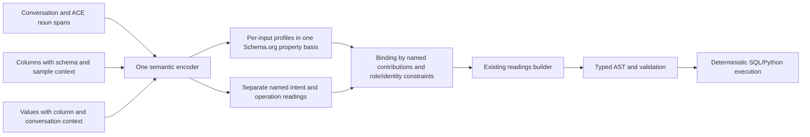

# Architecture

Status: **current runtime architecture**. Future changes are marked as targets or pending work;
they are not shipped features. See the [documentation map](README.md) for the difference between
current, opt-in, external, and planned behavior.

Prereasoner represents a question, its data, and its source evidence as named dimensions. The current
runtime composes those dimensions into a checked query plan, runs it, and returns the result with its
rows and trace. For the supported own-data subset, one immutable plan emits both a SQL view
stack and readable SQLAlchemy/Python source; see
[DETERMINISTIC_EMITTERS.md](DETERMINISTIC_EMITTERS.md). One frozen encoder (Qwen2.5-0.5B with a LoRA
adapter and a relational readout) supplies model evidence: it reads intent and schema signals as named
coordinates. Own-data questions take the Decisions path: an external closed-choice model answers closed questions
whose options the engine built, the engine's decoder builds every program as a typed AST, and one more closed
question chooses among the programs that run (see [Own-Data SQL Planner](#own-data-sql-planner)); no model writes
those queries. The one written query is the retry (`engine/retry.py`): an answer the choice holds most likely wrong,
or one the person retries, is answered by a SQLite query Gemini 4 Neon writes, shown with its SQL.
No model writes Python or a numeric answer, and model text never reaches a database. AST construction,
routing, joins, validation, selection, emission, and execution are deterministic for fixed inputs,
configuration, database state, and model files.

Read [GETTING_STARTED.md](GETTING_STARTED.md) first when setting up the repository. Read
[SQL_AST.md](SQL_AST.md) for planner internals, [SOURCE_DATA.md](SOURCE_DATA.md) for
publisher-owned references, and [../db/README.md](../db/README.md) for the database contract.

## System Boundaries

```text
browser, Google Sheets add-on, or MCP client
        |
        | authenticated request: tables, question, optional conversation and analysis intent
        v
engine/server.py
        |  bounded JSON parsing, canonical request validation, auth
        |  conversation/analysis ownership and private-reference selection
        |  private-reference adapter
        v
engine/knowledge.py
        |  one serving entry point
        v
engine/routing.py
        |  a question the search reads whole from the upload builds no compose plan and needs no
        |  world lookup (reads_upload_whole, asked of the search probe's pool); a pool reading that
        |  names a value the upload holds nowhere ("Europe") leaves the decision to compose
        |
        +-- DELEGATE --> own-data typed AST, local composition, or ordinary world lookup
        |
        +-- COMPOSE  --> world-dependent multi-step view composition
        v
guarded execution on the request's SQLite database (engine/prepared.py)
        |  supported shared plan: bounded Python/SQL, or both for parity
        |  other plans: SQL; explicit Python/verification rejects the fallback
        |
        +-- engine/provenance.py: typed expression and source lineage
        +-- response: rows, SQL, evidence, provenance, and source releases
        +-- optional Firebase RTDB progress events
```

The optional `orchestrator/` service wraps this API in a conversational tool loop. `mcp_server/` exposes the same
engine operation to MCP clients. Neither component owns data reasoning or may invent a numeric result. A chat turn
is normally one Gemini call at LOW thinking, whose tool call carries the question, the analysis action and its
slug; a second call follows only when the engine asks for a split or cannot read a follow-up. Each call waits at
most 20 s and is sent once more after a timeout, a 429 or a 5xx (`engine/llm.py`): Vertex's shared pool holds a
single request for a minute or two now and then while its median stays under 2 s.

## Execution backend boundary

`engine/deterministic/plan.py` owns the shared topologically ordered stage DAG, table identity, scalar attribute names, and
join-edge selection. The emitters own only source generation. `service.py` chooses the backend and
owns a shared database snapshot when given an engine; `runtime.py` loads generated modules, executes
temporary SQL views, and compares materialized stage rows. Production uses the existing PostgreSQL
conversation and knowledgebase schemas in either mode.

The request's `use` preference flows from the browser through `/chat` or `/api/reason` without changing
process environment. `context.py` creates a transient `query` context for every direct request, or uses
the named analysis slug and revision. The server checks the final response before saving an
analysis: explicit Python/verification requests cannot accept a legacy SQL fallback. Successful
responses identify the requested and actual mode; the MCP adapter preserves that evidence.
The knowledge-query adapter also preserves the own-data delegate's generated program and stages.
Its coverage check reads the complete emitted SQL program so a filter in an earlier stage is not
mistaken for a condition missing from the final aggregate. A word the tagger reads as a finite verb or
an adverb ("which item sold the most units") is covered, because it says what the rows did, and so are a light
verb's participle ("made"), the rows an aggregate is taken over ("the average score of the leads") and an
adjective an ordering grades ("the most expensive event"); other participles, words the data holds as values,
and the payment and listing states are still checked. A month word is covered when the SQL compares a date
column with that month or date (`engine/sql_dates.py:realized_month_words`), and a duration's words when the SQL
compares a span by them (`engine/sql_durations.py:realized_duration_words`).

The own-data `TableQuery._serve_ast` winner, world planner's grounded slots, and selected
ComposeEngine primitive records have separate lowering adapters under `engine/deterministic/`.
They feed the same plan, emitters, and runtime; none is another planner. The routing authority still
requires a necessary world dependency before ComposeEngine owns a world answer, but an explicit
`python` or `verify` request can lower a selected local composition as well. World ORM relationships
use the request's cell-to-QID bridges and the knowledgebase rows its tables reach. Composition retains its
SQLite candidate-materialization step for operand binding/routing, then runs the selected typed
program through the shared runtime. Unsupported shapes still fail closed for explicit Python/verification.

`engine/decomposition.py` is the only compound-question fusion boundary. A normal request always tries
the ordinary planner first. If its selected AST is compound, the engine returns a non-terminal
`decompose` status without answer rows. The orchestrator may make one engine-triggered retry with a
closed natural-language proposal: two to four leaf questions, one to four `cross`/`anti_join` merge
nodes, one output, and a stated grain. Runtime guards require the exact original question and analysis
request identity, reject proactive or repeated decomposition, reject dead nodes, and bound Cartesian products
by explicit leaf limits. A leaf may keep only a row cutoff the decomposed question states, so a proposal
cannot meet that bound by inventing one. The existing AST planner independently binds every leaf; common dimension keys
for an anti-join come from those typed relations, and the evidence relation must preserve every physical
dimension in the left input's grain: an evidence leaf serves the first of its contract-compatible
readings, in ranked order, that does. The result is one `AnalysisPlan`, not independently
generated SQL and Python and not a model-executed chain of partial answers.

Temporary SQL views are evaluated when read, whereas Python stages retain tuples. Current trace
collection materializes every stage in either mode, so SQL mode is not a bounded-memory streaming
executor. `auto` prefers Python for an estimated total of at most 10,000 input rows and SQL above it.
The Python combined query and every materialized stage enforce that cap; underestimated expansion or
another Python failure rolls back a savepoint and records an emitted-SQL fallback. The threshold is a
deployment policy and must continue to be checked against production-shaped benchmarks.

## Data Scopes

The PostgreSQL deployment uses five distinct scopes:

| Scope | Schema | Contents |
|---|---|---|
| Wikidata shared data (legacy names) | `knowledgebase`, `public` | Current resolution index, taxonomy, Wikidata-backed entity tables, and staging/geo data; target migration is described below |
| Synchronized reference sources | See `SOURCE_DATA.md` | Nine publisher-owned schemas with active physical releases; logical datasets remain separately deployment-gated |
| Application metadata | `chat` | Admin-migrated conversations, named analyses and immutable revisions, source manifests, ownership, quota, activity, and expiry tables; serving receives DML only |
| Prepared tables | `chat.prepared_table` | Each conversation table's preparation: its routes, every cell's candidate entities, and the knowledgebase rows they reach (see The Request Database) |
| User | `m_<md5(subject)>` | Reusable private reference tables |

The verified Firebase subject determines the user scope. A client-supplied conversation id is accepted only after
an ownership check. Client input never selects a user schema directly. Conversation schemas (`c_<32hex>`) from
releases before the request database hold nothing a question reads; they are dropped once that release has soaked.

## The Request Database

Every question runs on one private SQLite database (`engine/prepared.py:RequestDatabase`), built when the request
starts and closed when it ends. `main` holds the request's tables as the planner types them (a REAL column as
canonical decimal text ordered by the `decimal` collation, an INTEGER column as integers), the cell-to-QID bridges its
world routes build, and the hybrid search's vectors; `knowledgebase` holds the part of the knowledgebase the request
can reach. The own-data path's program tables (`_t0`, ... over the request's workbook: `program_tables`), its
verification of every candidate, the decomposition probe, the deterministic plan of every route, compose's
lowering, the world path's freshness, coverage and unmatched-row checks, the hybrid search and the resolution
slides all read it. Nothing else writes it, so no question waits for another, on one conversation or across them.

The knowledgebase part starts from the instance's base image: the small tables whole (`country`, `Countries`,
`States`, `u_s_state`, `Elements`, `Continents`, `schedule`, `types`), the column catalog of every knowledgebase
table, and the labels of every country, continent, state and element, rebuilt when the knowledgebase refreshes.
Each request table then adds its preparation: the rows of the cities and other entities its cells can name, and
their labels. A conversion adds the exchange rates of the days its fact table names, read once per instance.

A table is prepared once per version of its content (the synthesized currency column a dataset op adds does not
count): its routes and typing evidence, every candidate entity of each distinct cell of a routed column (a cell
can name several Parises; the country a question names chooses among them), the Schema.org evidence and dominant
entity type of every other column, the entity each of that column's cells names, and the knowledgebase rows and
labels those reach. Preparation reads PostgreSQL and the models; it starts in the background when a client syncs
its sheets (`/api/conversation/sync`), else the first question computes it, and a question that arrives meanwhile
waits for it instead of preparing again. It is kept in `chat.prepared_table` for the conversation (the newest 64
records per conversation, deleted with it, not counted against the user's storage) and cached in the process. The
same background step then encodes the stock reading's vectors of each table's targets (`keep_sheet_vectors`: bge-m3
over its cells, column names and labels, about 18 texts a second on 8 threads and 7.5 on 4) and keeps them there under
their own key, by the table's content and the stock model alone, so a knowledgebase refresh keeps them; a question on
any instance holds them before its reading (`hold_sheet_vectors`). Measured 2026-11-20 on a 10,000-line sheet of 2,024
targets: the first question's reading took 124.6 s when it encoded them, 0.4 s after the background step.

At question time PostgreSQL answers only what the request cannot hold: conversation records and saved
references, the exact-name lookup of the question's words (each name cached per instance), the exchange rates of a
conversion (cached), labels missing from the image, and the nearby-places search over `public.settlement`, which
reads no upload. A country, continent or state word is matched against every name of its type exactly, in memory;
a fuzzy city word only against the cities the request's tables name, since a city they do not mention matches none
of their rows.

SQLite has no exact decimal type, so the database registers the decimal functions (`engine/numeric.py`): the SQL
program computes arithmetic, SUM/AVG/MIN/MAX/MEDIAN/STDEV, comparisons and ordering through them and returns numbers as
decimal text, which the runtime reads back as Decimals; the Python program's columns read the same text through
`ExactDecimal`. Both programs agree exactly at every stage. `lower()` and `upper()` fold every alphabet, text sorts
by code point in both programs, empty values sort last in both directions, and a statement ends at the request's
deadline (a progress handler).

Private references are not added wholesale to a SQL `search_path`. `engine.master.relevant_tables()` reads every
saved key, applies the production foreign-key detector to uploaded and saved tables, and selects only references
connected to the request. Selection runs to a fixed point, so a valid multi-hop chain can be included. A selected
reference larger than the request's row budget (`engine.server.MAX_REFERENCE_ROWS`) keeps every row whose key the
working tables name, fills the budget with the others in key order, and says in a warning what it left out; one
naming more rows than the budget is not used, and a warning says so. Selected references then become ordinary typed
planner tables; there is no reference-specific SQL generator. The detector compares keys as the executed join does
(`engine.relations.join_keys`: a column of numbers by exact magnitude, any other column by each cell's exact text),
so a reference the uploads match only when case is ignored is not joined; the same detector over case-folded copies
names it in a warning.

## Semantic Contract: Vocabulary, Observations, And Facts

Keep these three layers separate:

1. **Schema.org is the vocabulary.** The pinned Schema.org 30.0 contract defines the classes,
   properties, inheritance, domains, and ranges that training and serving can name. A coordinate
   can be represented even when the current corpus has no examples for it.
2. **Source-owned datasets supply observations.** Wikidata properties are mapped to Schema.org
   properties, and publisher relations are exposed through explicit source mappings. Wikidata is
   the main public entity-identity bridge; it is not the authority for facts owned by IANA, CLDR,
   GeoNames, ECB, CDC, NLM, or another publisher.
3. **Versioned source releases supply answer facts.** Models learn how a question and a column fit
   together, not mutable values. A model may recognize an exchange-rate relation, but the dated rate
   still comes from a pinned ECB release and must pass temporal and calculation checks.

There are currently two learned stages over this contract. The shared encoder uses a historical
71-property compatibility basis derived primarily from capped Wikidata observations, plus
structural, intent, and calculation training. The active named-dimension head uses the newer
multi-source Schema.org corpus and emits calibrated class proposals consumed by `engine/router.py`.
It can propose a resolver family but cannot authorize a join or change a numeric answer. These are
distinct artifacts, and their corpus and metric claims must remain separate. See
[TRAINING.md](TRAINING.md) and [MODEL_CARD.md](MODEL_CARD.md).

## Domain Semantics And Enrichment

Market-led domain profiles and deterministic shared-reference enrichment are specified in
[KNOWLEDGE_ENRICHMENT_ROADMAP.md](KNOWLEDGE_ENRICHMENT_ROADMAP.md). The active publisher
inventory is recorded in [SOURCE_DATA.md](SOURCE_DATA.md). A physical source release being
active does not make it planner-visible. `iana_country` is the first code-approved logical
dataset in the generic enrichment registry. Raw Terraform still requires
`ENRICHMENT_ACTIVE_DATASETS=iana_country`; the guided Community deployment sets it after the
database grant step. The raw Terraform default remains empty.
The production request flow now contains the guarded integration boundary: explicit intent,
domain-role recognition, database-backed registry selection, request-local materialization,
trusted-edge propagation, and serving provenance. Currency conversion is a deliberately
bounded exception to the still-disabled generic temporal registry: the ECB sync is transformed
offline into a release-labelled daily `knowledgebase.exchange_rate` projection, and the world
planner joins dated facts on the exact `(currency, date)` pair. It carries the prior published
business-day value only during projection construction, never through request-time network or
latest-prior SQL. The calculation verifier proves direction and aggregate arithmetic; missing
coverage fails closed. Each row is converted before the rows are combined, so a conversion is a SUM
(`total_<ccy>`) or an AVG (`average_<ccy>`) as the question asks; either is computed per the uploaded
column or world attribute the question groups or ranks by, and its evidence records that grain. No embedded or demo FX fixture is a production fact source.

The target source-materialization design makes the database boundary explicit: physical shared
schemas are source-owned (`wikidata` after its pending migration and the publisher schemas in
`SOURCE_DATA.md`), while domain roles describe request-private operational tables and classify
source datasets in the planner registry. Each new publisher source owns a versioned `release`
table. The target `public` schema contains no application data, but the current runtime still uses
legacy `public` Wikidata staging and geo tables declared by `db/init.sql`. `engine.relations` remains the
relationship-graph owner, and the existing typed AST remains the only SQL planner. Enrichment does not add a router,
planner, or request-time network path.

Existing Wikidata country, currency, timezone, city, and administrative-area tables migrate from legacy
`knowledgebase` and `public` into source-owned `wikidata`. IANA and CLDR facts remain in `iana` and `cldr`; they are
linked to Wikidata by explicit registry edges and are not copied into domain schemas. Each source fact has one
writable owner and each exposed relation has one planner role.
The measured baseline found incomplete/mixed Wikidata code data and empty timezone staging, so M1 uses pinned IANA
and CLDR snapshots. Each implemented refresh inserts a complete immutable release and activates it atomically;
upserting into active reference rows is prohibited because it retains upstream deletions and breaks deterministic
replay. The legacy Wikidata schema migration is still pending.

## Request Flow

1. `db/init.sql` plus the privileged application migration command prepare shared `chat` metadata before deployment.
2. `engine.request_validation` validates both engine and orchestrator request shapes. It bounds questions, history,
   table count, per-table size, and aggregate size, then converts display names into one 34-byte canonical table
   identifier. Names that collide after canonicalization are rejected before parsing or paid inference.
3. A client uploads a conversation's sheets once per change: `POST /api/conversation/sync` stores them (starting the
   conversation when there is none) and returns their `source_hash`. A question then names them by
   `conversation_id` and `source_hash` instead of carrying them; `/chat` reads the stored copy for its own checks and
   names it on each engine call, and the engine answers 409 with the stored hash when the sheets were replaced since,
   so the client uploads again. `engine.server` verifies the Firebase principal and ownership on every call and
   parses each stored snapshot once per instance (an inline upload in the request is stored the same way). A request
   repeated with
   the jobId of one the same principal already sent is answered with that request's response, waiting while it
   still runs (`engine.request_replay.DurableResponseReplay`: one `chat.request_job` record shared by every engine
   instance, kept ten minutes after its response and removed when the user deletes a conversation); the chat's
   engine client repeats a request once, with its jobId, only when the response is lost in transport. Browser XLSX
   parsing is isolated in `web/public/lib/xlsx-worker.js`, which uses a vendored SheetJS build with compressed, expanded,
   row, column, worksheet, and time limits. Host grids (the Excel add-in's and the Google Sheets add-on's cells)
   are written as the workbook those cells would export to and take the same worker, limits and layout rule, so a
   sheet reads exactly as an upload of it would. `sheets-addon/` is a read-only Apps Script add-on. Its sidebar is
   its own UI in Sheets' style and renders turns with the web rail's shared component (`web/public/lib/turn-renderer.js`).
   Live steps come from the web's subscriptions (`web/public/lib/firebase-init.js`), and the sidebar reads the cells
   with the upload importer (`WORKBOOK_IMPORT.convert`). Its Apps Script server returns the visible, non-empty tabs'
   cells and calls `/chat` and the conversation APIs server to server with the user's Firebase identity. It does not
   implement reasoning and never writes to the spreadsheet.
4. `engine.master` validates or selects private references. `engine.relations.discover_fks()` is the canonical
   relationship detector used here and by planning (`relate` merges declared keys with it: a declaration blocks a
   discovered parent for its column only where its name names its own parent at least as well), and
   `engine.relations.join_keys` is how it reads a column's keys.
   Discovery, the planner's schema and the schema graph are each derived once for equal cells
   (`engine.relations.memoized`), and each process keeps the latest across requests, bounded by cells and by time
   since use.
5. `engine.server` resolves the conversation id and verifies ownership before selecting its working schema.
   Uploaded data changes advance a monotonic dataset version and mark prior analyses stale. `engine.pg` hashes
   each materialized working table and leaves unchanged uploaded, private-reference, and enrichment tables in place.
6. For named requests, `engine.analysis` validates the create/modify/inspect intent and
   `engine.conversations` reserves the engine-owned analysis id and revision. An inspect request loads an exact
   completed revision without invoking the planner.
7. `engine.knowledge.KnowledgeReasoner` receives the complete working table set, the question and the tab the
   client has in view (`active_sheet`, a canonical table name), which the request database carries to the own-data
   path's records. The sheet compiler reads tabs that are copies of one layout (an export kept per product or month)
   as one family, and the read-as line names the tabs it read.
8. `engine.routing.route()` makes the single world-composition ownership decision. A necessary world
    dependency may be owned by ComposeEngine; self-contained data remains authoritative in the typed AST,
    while selected local analytical compositions can still be lowered into the shared plan for explicit
    SQL/Python execution.
9. The selected planner emits a typed query. Supported shapes lower to one shared plan and deterministic SQL/Python
   programs; the request policy executes bounded Python, SQL, or both on the request's database, which holds the
   request's tables and the knowledgebase rows they reach. A selected compound own-data AST may request the one bounded
   decomposition retry described above; all leaf planning and merge binding remains inside the engine. Other
   unsupported shapes remain on guarded, quoted, read-only SQL.
10. Cross-route calculation verifiers inspect typed planner evidence before a result is released. Without changing
   scores, the shared registry selects the best-ranked candidate that realizes every detected calculation. An
   unmet or ambiguous calculation replaces the numeric result with a structured clarification.
11. `engine.provenance` maps typed output expressions to their exact table/column operands and propagates source
    identity through emitted views. Publisher adapters provide release IDs. The browser renders this contract and
    never classifies a column by its name.
12. A successful named request prefixes every derived view with the canonical analysis slug, stores the exact
    response in an immutable revision, and returns the engine-owned descriptor. A failed or clarified request does
    not replace the last completed revision.
13. The engine returns rows, SQL, route evidence, intermediate views, and provenance. Trace writes are best effort
    and do not determine the answer. Every emitted view stack follows the one derivation-trail contract in
    `docs/SHEETS_AS_REASONING.md` (step grammar, no forward references, executed program only); emitters extend that
    grammar in place rather than inventing per-path sheet shapes.

## Request And Provenance Contracts

There is one request validator, `engine.request_validation`; the orchestrator imports it directly. A table
display name never reaches SQL directly: `engine.request_validation.canonical_table_name()` removes known file
extensions, normalizes to ASCII, reserves space for runtime bridge suffixes, and hashes overlong names. The engine
revalidates orchestrator calls at its own trust boundary.

Provenance has two inputs. Source records describe uploaded tables, selected private references, and activated
publisher snapshots. Computation records come from the selected typed AST and name each output expression,
operator, and qualified operand. Intermediate view records propagate those origins through the emitted operation
stack. `column_provenance` is aligned positionally with `columns`; an absent or malformed record is not inferred by
the browser. A quantity the engine computed (an aggregate or arithmetic output) carries `measure: true`; the reply
renderer (`engine/answer_presentation.py`) formats only those numbers and writes a value taken from the data, such
as a year or an ID, as it is. Provenance explains the computation that ran. It does not certify that the selected query was the
correct interpretation of the question.

## Own-Data SQL Planner

The own-data path is the Decisions path (2026-11-20; it replaced the trained readers, `DECISIONS.md`). The one
selection is `engine/tables.py:TableQuery.select_query`: the request's tables are read as one workbook, the question is
answered by `engine/program/answer.py`, and every candidate is a typed SQL AST the engine built. An external
closed-choice model, the Decisions API (Gemini's Developer API, called only through `engine/llm.py:decide`), answers
closed questions whose options the engine built and returns probabilities only; it never writes text, SQL or a
program. A second judge (`engine/llm.py:judge`, `JUDGE_MODEL`) answers the choice's question with the key of one of
its options and sets an answer's mark, never the answer (step 5). Only the retry (step 8 below) runs a query a model
wrote.

| Owner | Responsibility |
|---|---|
| `engine/tables.py` | The request table's grid (`table_grid`, given to every table by `normalize_tables`), the one selection (`select_query`), its run (`_serve_ast`), the response (`serve`), the SQL guard and the one executor (`execute`, `_execute_deterministic`, on the request's database) |
| `engine/prepared.py` | The workbook's preparation, once per content (`prepared_workbook`), and once per what a request's links reach (`connected_workbook`); the request's links (`RequestLinks`, built by the linker the world layer registers, `RequestDatabase.link_with` and `links`); the request database's program tables (`RequestDatabase.program_tables`), the request's answer to a question, once (`RequestDatabase.answered`) and the tab in view (`RequestDatabase.active_sheet`) |
| `engine/program/connected.py` | The connected catalog: the request's links placed on the workbook (`links_on`), what each reaches on the request's database (`reach`) and the columns it adds (`connect`) |
| `engine/knowledge_bridges.py` | The request's links (`request_links`: routes and their bridges, entity columns, keys, money columns and their rates) and their registration per served request (`link_request`) |
| `engine/sheet/` | The sheet compiler: tabs to tables (headers, sections, printed lines, families of copies, a text column's figures as number columns of their own: `Score #1`, `Score #2`), the wire form a host sends (`payload.py`) |
| `engine/program/answer.py` | `prepare` and `answer`: the stock reading, the closed-question calls, the decoder, the verifier, the choice, the second judge's call beside it and the per-answer decision |
| `engine/program/closed.py` | The sheet's description, the closed questions per slot and the added ones, the fused reading, the choice record and the per-answer decision (`choose_answer`, `T_ERR` 0.42, `T_FLAG` 0.575, the two judges' agreement: `DOUBT_*`) |
| `engine/program/stock.py` | The stock reading: the word reader plus stock bge-m3 similarity (the shortlist of options) |
| `engine/program/dates.py` | Text dates typed by one Decisions call when a workbook is prepared |
| `engine/program/catalog.py`, `language.py`, `decoder.py`, `verifier.py` | The workbook's tables, the program language, the typed k-best decoder (50 programs) and the verifier's named evidence |
| `engine/program/lowering.py`, `store.py`, `execute.py`, `output.py` | A program as a typed AST and one plan (`to_query`, `to_plan`) over the request's store tables (`_t0`, ... on the request database); its rows as the sheet spells them (`displayed`); its read-as line, answer column names and sheet formula |
| `engine/named/` | The stock reading's backbone (`backbone.py`: bge-m3 by pinned revision) and shared reading types |
| `engine/sql_ast.py` | Immutable query nodes, type/visibility validation, rendering |
| `engine/sql_rank.py` | The selection record (`PoolSelection`); `analyze_question` for the calculations |
| `engine/decomposition.py` | The length rule (`ONE_QUERY_WORDS`), closed proposal validation and fusion of the leaves' programs into one shared DAG |

1. Each request table carries its grid: an uploaded sheet's CSV as plain rows (blank rows kept, cells typed as the
   planner types them, trailing blank columns trimmed), else its header and rows. A currency a conversation states is
   the grid's unit for its column (`dataset_semantics.apply`; the compiler gives the column that unit), never a column
   the grid gains. The workbook is one tab per table, named as the
   table is, in the request's order.
2. `prepared_workbook` compiles it, types its text dates (one Decisions call), warms the decoder and lists each
   table's targets, once per content, kept in the process (`WORKBOOK_CACHE_CELLS`); in a served request the stock
   reading's vectors its conversation keeps for its tables are held before the reading (`hold_sheet_vectors`).
3. In a served request the world layer's links connect it (`engine/program/connected.py`). `KnowledgeReasoner._serve`
   registers `link_request` on the request's database; the own-data path's first read of the workbook builds the
   request's links once (`request_links`): each routed place column's bridge (production's own pairing), each column
   of named entities its preparation types (on a table with no place column) with the bridge of its cells' matches,
   the single-column keys between the request's tables, and the money columns in their rows' currencies with the
   rates of their days and of the as-of day. Each place or entity column whose bridge holds at least three of its
   distinct cells (a place column only where most of its cells route) gains the knowledgebase columns it reaches, read
   as joins on the request's database ("city → country", "city → country → continent", "city → population", "bank →
   country"); each key whose values are unique in the other table gains that table's columns ("customer → tier",
   "customer → city → country"). When the money columns can be read in other currencies, one closed question asks
   which currency the question wants its answer in (`convert_target`, offered from 0.1); its converted columns join
   ("amount → USD", the rate of the row's currency on the row's day, the as-of day without a date column), stating the
   currency as their unit. The connected workbook is prepared once per what its links reach (`connected_workbook`),
   and a value a key and its column both hold is read as one value in the value sets. A database with no linker (an
   evaluator's scratch database) reads its workbook unconnected. In the served chain the world path still answers
   first what it claims (a place filter, a projected world column, a bound conversion: `KnowledgeTableQuery.serve`, the
   non-geographic world join); the connected columns serve the compose probe and the questions the world path passes
   on to the delegate.
4. The stock reading scores the program language's coordinates; the reading record offers each slot its options and
   one Decisions call answers it (a second answers the value sets, and a third, beside them, reads which of the
   question's own words name a comparison's two outcomes; a fourth, beside them too, whether the question takes lines
   by where they stand in a table, the first ones or the last, whether it counts the most lines in a row, whether it
   asks for a median or a standard deviation, and whether it keeps rows whose number lies between two numbers it
   states: what the reading call's aggregate and comparison questions do not offer). The fused reading feeds the
   decoder's 50 most probable
   programs, each run by the verifier on the request's store tables. Lines taken by where they stand answer with
   their cells (a rank by `LineOrder`) or, where the question states how many and the reading holds a figure, with
   a total, an average, a lowest, a highest or a count of them (`Agg.taken`, "the average age of the first three").
5. The programs that returned rows are listed. One Decisions call weighs them (each its read-as line and a preview
   of its answer, and "none of these"); per answer, a candidate's probability is summed over the candidates returning
   the same answer. The likeliest answer is answered at `T_FLAG` or more, warned from `T_ERR` (or when another
   answer's reading reads word for word like it), and most likely wrong (`ERRED`) below that or when "none of these"
   is likelier. It is never asked back for (owner, 2026-11-21). Two judges must agree for an answer to go unmarked
   (owner, 2026-11-26): beside the choice, the same question (the same sheet description, instruction and options)
   goes to a second model (`engine/llm.py:judge`, `JUDGE_MODEL`: Gemini 4 Neon at low thinking), which answers with
   one option's key; an answer the choice would give unmarked waits for it and is warned when the judge picks another
   answer (shown as what it may also mean), picks none, or does not answer (`PoolSelection.doubt`). An answer the
   choice warns only because its own probability is below `T_FLAG` waits for the judge too and is given unmarked
   where the judge picks it (2026-11-27). The answer served is the choice's in every case; an answer with a reading
   worded alike and a most-likely-wrong one do not wait. The wait ends by the clock at the judge's own limit
   (`JUDGE_TIMEOUT_SECONDS` after it was asked); a judge call still out `JUDGE_SECOND_SECONDS` on is made a second
   time beside the first and the first of the two to answer is read (`engine/llm.py` `_first_to_answer`); and a
   compound question's part, whose listing alone is read, asks no judge (`select_query(..., marked=False)`). On unseen tables the answers given unmarked and wrong fell from 13.6%
   and 12.8% to 6.7% and 5.8% (`spider/results/RESULTS.md`).
6. `select_query` records it as a `PoolSelection`: the listed candidates (each its typed AST, SQL, answer probability
   and read-as line), ranked by that probability; `selected` (answered or warned), `warned` and `uncertain` (the
   coordinates the runner-up answer reads differently), or `erred` (the likeliest, when it is most likely wrong:
   nothing is decided, so compose and the search may answer it). A question longer than
   `decomposition.ONE_QUERY_WORDS` (30) words whose answer is most likely wrong asks, in an analysis, for the
   decomposition proposal (`decomposition.declined_compound`); one it answers is answered.
8. Any other erred answer is retried (`engine/retry.py`): Gemini 4 Neon (`engine/llm.py:write_query`, the Developer
   API, low thinking) reads the workbook the Decisions path reads (`TableQuery.workbook`: each compiled table with
   the columns the request's links reach, `retry.workbook_tables`; columns typed by their cells, row counts, first
   lines, a text column's few values, the tab in view) and writes one SQLite SELECT, which the one guard checks and the request's
   database runs read-only over TEMP typed copies (a failed query goes back once with its error). Its rows are the
   answer; its word that the tables cannot answer the question is the one question back; a retry that cannot answer
   leaves the likeliest reading served, marked most likely wrong. The person's Retry (`retry: true` on `/chat` and
   `/api/reason`, `TableQuery.retry_answer`) runs the same retry.
7. In an analysis, as every served request is, the chosen program's one plan runs through both deterministic
   emitters on the request's database (`TableQuery._execute_deterministic`), in exact decimals, and its rows are
   shown as the sheet spells them. Outside one (an evaluator), the answer is the rows the choice read. Either way
   the answer is given in the sheet's terms (`engine/program/execute.py` `answered`, `PoolSelection.answer`), though
   the choice read True or False and stored values: a verdict says Yes or No, and a cell taken from a column of
   numbers or days reads as the sheet writes it ("£3.00", "April 27, 1966").

The served response carries `read_as`, the chosen program's plain reading, which the thread shows as the turn's
"read as" line, and a `coverage` record certifying the reading (the world routes keep their own wording gate in
`KnowledgeQuery._uncovered`). Every own-data answer carries its mark, `check` (`engine/tables.py:answer_check`,
`retried_check`): `answered`, `warned` (with `coordinates`, `also_read_as`), `erred` or `retried` (with the retry's
query, model and reason), each with the reason its icon opens on beside a Retry (`web/public/lib/turn-renderer.js`
`renderCheck`, in the web rail, the Sheets sidebar and the Excel pane); the reply is the answer alone. A total or average of a named column whose cells are not all
numbers is refused naming them (`engine/query_contract.unreadable_operand`) before any route reads it
(`KnowledgeQuery.serve`), by compose and the currency check alike.

The response's `planner.selection` records the pool's size, the served member and its rank, the likeliest answer's
probability, whether it is warned, and the likeliest member when its answer is most likely wrong.

A request answers a question once (`RequestDatabase.answered`) although compose's routing probe, the hybrid search's
check and the delegate each select. The program language reads one table at a time; what a served request's links
reach (step 3) is a column of that table, so a question over a place's country, a key's other table or an amount in
another currency reads one table. Two tables no single-column key with unique values links are not joined, nor is a
Spider schema read through its foreign keys (the Spider evaluator registers no linker). A request answers on one
connected workbook: a decomposition whose leaves want different currencies cannot share its database. A decomposition's leaves are programs over one workbook; an
anti-join binds the leaves' keys by the column each reads holds (`_bind_merge_keys` with `store.column_lineage`): a key
the request's links find, and each column a key reaches, hold the values of the column at the end of their chain
(`Catalog.identities`), so leaves over different tabs bind where the request's keys connect them. A fused answer's
folded key shows the sheet's spelling (`decomposition.shown_output`). A leaf that lists several columns of each record
("customer name and product name for each purchase") has no program yet: a listing shows one column.

The Spider evaluator (`spider/probe/full_eval.py`) and the dev replay (`regress/run_dev_decisions.py`) call the same
`select_query`. The Spider evaluator can partition its questions by input position and merge only exhaustive,
disjoint checkpoints with identical code, model, data and configuration fingerprints; sharding changes scheduling
only. The offline importer (`regress/sql_import.py`) turns test fixtures' SQL into typed ASTs; serving never uses it.

## Shared Property Binding Migration

This is the owner's required target, not the current production behavior. It was written against the trained
readers (`engine/readers`, `training/readers`), which the Decisions path replaced on 2026-11-20; the reader modules it
names are in git history before that change. Where this section speaks in the present tense of the readers, their
modules (`ReadingSearch`, `ASTGrammar`, `NamedSemanticModel`, `search_pool`), the re-scorer or the refusal, it
describes the code as it stood before 2026-11-20; none of it serves today. Noun, column and
contextualized-value meanings share a compact, selected property basis. Reuse the existing selection
in `engine/data/alloc.json` and its provenance in `training/props/`, rather than allocating all 1,521
ontology properties. The original basis had 67 property coordinates; the current allocation has 71
property-named, 9 structural and 10 intent coordinates. `families.json` uses 47 distinct properties
across its family signatures. Selection uses training support (at least 25 instances, plus explicit
biology anchors), followed by distinctive family evidence (in-family firing at least 0.15 and at
least three times the out-of-family mean). These are support/discriminability rules, not evidence
that every ontology property underwent a downstream accuracy ablation.

The later URI-indexed head separately trains 80 properties and qualifies 56 for release. Its
qualification is not a replacement for the historical basis-selection rationale. Freeze the reused
coordinate order, resolve historical non-property names explicitly, and justify any additions by
coverage and held-out task evidence. `engine/schema_org.py` and the pinned Schema.org 30.0 artifact
provide vocabulary validation and inheritance; their full catalog is not the model dimension budget.
Nouns, columns and values are different input roles with distinct identities and
contexts, not different semantic spaces. The readers this was written against and the interrupted CLEF
AST candidate did not expose that common interface: their opaque table/column/value scores were not
property contributions, even when their final SQL tree could be inspected. The Decisions path's
shortlist (stock bge-m3 similarity and the word reader) and its closed choices are not property
contributions either.

The migration extends `engine/schema_model.py` and the existing semantic encoder/reader owners.
One trained profile interface must cover all three roles. Coordinate meaning, scale, masks and
qualification belong to a frozen vocabulary/label contract. Expected concept-property evidence and
observed instance-property evidence are distinct supervision sources; unknown or missing observations
are masked, not silently labelled false. Ontology compatibility bounds possible properties and does
not itself prove that a particular instance has them. The existing table-property head's calibration
cannot be assumed to transfer to nouns or individual values.

Semantic binding must consume these profiles and expose the exact per-property contribution,
normalization, role/relationship gates and deterministic tie handling. Opaque encoders may read
context upstream; opaque residuals, schema pruning or value-pointer scores must not independently
choose a semantic binding downstream. Retained proposal retrieval must be identified and evaluated
for recall. A property explanation added after an opaque choice does not satisfy the contract.

Profiles retain physical table/column/cell pointers, dataset versions, literals and grounded
entity/source keys. Paris and Lyon can have similar city profiles while remaining distinct values.
Departure and arrival columns can share a type while requiring different argument/relationship
roles. Unresolved identity or role ambiguity must abstain. Operations such as COUNT and SUM use
separate named intent/operator coordinates, not invented Schema.org properties.



As written, accepted bindings and operation readings fed the readers' builder
(`engine/readers/readings.py:build`, deleted on 2026-11-20; the Decisions path's decoder,
`engine/program/decoder.py`, now builds every own-data typed AST), typed AST, validation,
deterministic SQL/Python emitters, request database and `TableQuery.select_query`. A migration must
replace the current semantic binding callers coherently and leave one promoted bundle and selection
path. It must inventory the property-head consumers in `engine/dimension.py`,
`engine/knowledge_typing.py` and `engine/router.py`, preserve their evidence and source-key
authorization, and recalibrate affected consumers before promotion. No serving migration has
occurred. An unqualified shared-head feasibility candidate has been fitted; it does not yet provide
recursive tree decisions or qualified cross-role bindings (see `docs/MODEL_CARD.md`).

Acceptance requires cross-role property calibration and alignment; schema/entity/rewording holdouts;
identity, relationship-role and property-poor-domain cases; and property-coordinate interventions
whose effects agree with the actual binding formula. Contribution sums must reproduce the semantic
score. Changing a hidden residual while holding the named interface and explicit constraints fixed
must not change the binding. These gates supplement strict answer accuracy, pool recall,
right/asked/wrong, wins/losses, latency and memory through the one serving evaluator. A separately
frozen experiment contract, data manifest and approved budget are required before new training.

### Defined candidate interface and evidence plumbing (2026-11-06)

`engine/readers/layout.py:named_coordinate_contract` (deleted with the readers) owned the candidate's
**215 defined coordinates**: 71 selected property URIs, 64 SQL coordinates, 32 bounded ACE meaning
frames, 32 structural/type/role coordinates and 16 dialogue controls. This is not the inherited
90-coordinate runtime allocation. The 10 inherited intents are inside the 64 SQL coordinates; the
nine structural signals are inside the 32. The proposal's AST-node-presence slots have become explicit
argument roles; recursive AST node tags and scoped identity edges remain grammar fields. Every
candidate coordinate starts uncalibrated. The frame vocabulary is an application meaning profile, not
APE grammar production names.

The property migration retires the class-named `GeoCoordinates` channel and trains the actual `geo`
property afresh. It retires `taxonName`, projects scientific-name observations onto `name`, and adds
`alternateName` as a separate alias target. These are new targets, not reinterpretations of old weights.
No existing runtime allocation or promoted bundle changes.

`NamedSemanticModel` and `NamedSemanticHead` in the readers' model owner (deleted 2026-11-20) used one backbone and
one shared projection. The CLEF construction discards the stock choice head and reads prefill states;
it does not invoke generation or export lexical/residual choice scores. `semantic_encode` places
schema/data and static column/value items before the conversation, then query items afterward.
Consequently CLEF's causal static profiles cannot see a changed question. Physical IDs remain return
maps, not input features. This is a non-autoregressive use of CLEF's causal backbone, not a claim that
its attention has become bidirectional. The candidate is not selected by the promoted runtime loader.

`engine/schema_decode.py:bind_profiles` compares expected semantic profiles. Each qualified,
known coordinate contributes `weight * (min(query, candidate) - abs(query - candidate))` in a pinned
integer scale. The denominator is fixed from known qualified query evidence; unknown candidates
reduce coverage. Exact score/coverage/margin gates, explicit datatype/relationship/identity constraints,
and ambiguity refusal are replayed with every contribution. `decisions.named_choice` maps its result
to an existing builder choice. This primitive alone does not certify other AST decisions or integrate
the shared model into serving. Zero profiles and ties cannot choose a physical identity.

Qualification is role-specific and pinned in `BindingBasis.role_qualified`; the global mask is exactly
its union. An omitted role has no qualified coordinates. The named head cannot export a coordinate
for that role, even if a caller supplies an all-true evidence mask. The binder independently applies
both query and candidate role masks and records their exclusions; an explicit identity cannot bypass
them. Unqualified five-field candidate records retain their identity. Globally qualified prototype
records without role-calibration evidence are rejected rather than silently licensed for all roles.
The comparison basis is the two declared roles' calibrated intersection, fixed for the candidate set;
unknown individual observations still reduce coverage. The meaning head only exports
`expected_concept` evidence. `observed_instance` profiles require verified source evidence and cannot
be manufactured by relabelling that head's probabilities.

The readers' `training/readers/gold.py:semantic_labels` (deleted 2026-11-20) derived all 64 SQL presence
labels and scoped argument occurrences from the validated typed AST. `training/readers/examples.py semantic` prepares
the original question/conversation state without inserting gold trees into input. The semantic fit
mode in the existing trainer uses directly supervised, masked BCE; unknown coordinates have zero
loss and gradient. Generated conversation controls require checked source-reading deltas and
matching original turns/schema. Source readings preserve ordering history that AST optimization may
rewrite into MIN/MAX. These annotations remain outside model input; arbitrary questions receive no
inferred negative dialogue labels. The Schema.org signature owner estimates expected source-observation profiles
from distinct real training groups with one annotated leaf class. These empirical priors are not
negative facts about individual entities. Synthetic noun/column concept witnesses and held-out
Wikidata value descriptions are labelled separately; the source relation's class-bearing prefix is
excluded from value input. This does not establish real-column or English-to-ACE alignment accuracy.

`engine/sql_ast.py` owns the recursive JSON schema and strict tree codec, derived from the same typed
dataclasses/enums as SQL validation/rendering. Schema compliance does not establish English meaning
or schema grounding. Historical experiment codecs are evidence, not active runtime owners.

The shared workbook importer now records compact output-row-to-original-sheet-row ranges and source
column letters, including skipped blank rows and separate summary rows. Request validation, snapshot
persistence, server parse caches and browser fingerprints preserve/bind this metadata. Embedded
newlines in summary cells do not inflate summary row counts. `ProvenanceContext.input_lineage`
captures an immutable parsed-input snapshot lazily. `InputLineage` provides original source addresses,
explicit section-label anchors/scopes and executor-supplied contributor occurrences, preserving
duplicates. It never guesses physical rows for older imports or infers blank-fill scopes from questions.
The existing Python execution operators now propagate source-row identities through projection,
filtering, sorting, fan-out, joins and grouping. The runtime shares one source-key pool across stages
and records output-row digests in Python execution order. `RequestDatabase.load` attests the exact
inserted snapshot/order; `ProvenanceContext.execution_lineage` resolves those keys against the
immutable request inputs and their importer address maps. Equal-valued duplicate rows keep separate
identities. Unknown origins remain unknown. SQL-only execution reports unavailable provenance.
This is positive source-row provenance, not minimal per-cell influence, negative-condition evidence,
or proof of learned named-coordinate decisions. Model-originated Enron binding traces remain required.

The same deterministic lowering owner implements projected-tuple DISTINCT with a grouping-only
`ReducedView`, preserving every duplicate contributor before ordering/limiting. A distinct query
cannot rank by an unprojected expression. Integer literals compared with text/date columns receive
SQLite's text affinity in the Python lowering, including reversed operands; numeric columns retain
numeric comparison semantics.

The unpromoted decision owner now also decodes finite SQL enum choices directly from role-qualified
named operation coordinates, using exact weighted prototype-distance terms and confidence/margin
gates. Enum aliases share their semantic prototype. Missing evidence refuses; replay rejects changed
contributions. `NamedSemanticModel.read` consumes the same input-only item bank as training in one
prefill, exporting qualified profiles without a second choice head. Scoped operator requests are
created before targets; inactive slots retain unknown labels and zero gradient. That bounded bank remains
an adapter for the source readings format. The joint candidate uses the recursive controller below;
earlier candidate weights/data retain their frozen contracts and do not become qualified by this code.

`engine/readers/grammar.py:ASTGrammar` traverses the SQL owner's recursive JSON schema. It constructs finite,
input-grounded choices for sources, scoped columns, literals, lists, node forms and executable enums. Aliases
are alpha-normalized; all join sources precede join predicates. Sources and scope mappings remain grammar
facts, and no target/predicted AST prefix enters the encoder bank. Forced and learned choices both count
toward the explicit position bound. `NamedSemanticModel.read_query` performs one encoder prefill, combines
each position state with its explicit candidate states, and applies the same 215-coordinate projection.
Only qualified conditional role/operator propositions cross that bottleneck. `decisions.named_field_choice`
uses exact quantized values, complements for absence, and score/margin refusal; there is no pointer, lexical
residual or independent re-scoring head. `replay_query_trace` rebuilds successful ASTs and refusals without
an encoder and rejects changed candidate domains, contributions or inputs. `ace.encode_query/decode_query`
expose a lossless canonical application ACE view of that same tree. This is not independent validation of
a fluent ACE reformulation of the user's English.

Offline corpus preparation and the recursive bank share `grammar.source_schema`:
physical names, observed types, original sample values and source-hash-verified
publisher column descriptions. Explicit recovered database manifests pin both the
author input and the restored file; a new source version invalidates earlier
execution witnesses even if its AST is unchanged. Small reference tables expose
aligned ID/description rows with a 128-row/12,000-character additional evidence
bound. Generic word-form, calendar, clock, duration, unit and observed email-domain
candidates preserve original cells and never select a meaning by themselves.
`Sources.question_graph` retrieves additional rows using input names, labels and
bounded reference-description matches. Low-cardinality related values can be
sampled through declared relationships or equal-named, data-discovered proposals;
this does not authorize a new planner relationship. Every sampled value is part
of a complete, actual source row. `SchemaGraph.source_rows` identifies those rows
so the grammar can expose their cells even when a code shares no question words.
The same row and text bounds limit these facts. Filtering a table removes its
row markers too.

The recursive literal bank retains its relevance-ranked source choices and adds
at most three compact observed strings for each of at most nine input-overlapping
words per source column. Rare overlaps precede frequent ones; all ordering is
stable. This keeps repeated long labels from crowding shorter recorded spellings
out of the bank, without inventing an alias or deciding that two names denote
the same entity. Numeric reference keys pass to SQLite through the existing
canonical decimal representation instead of binary-float conversion.

Preparation and auditing use this owner. An unfinished optional read discards
every newly retrieved row and retains the original input bank with an unavailable
receipt. The grammar still rejects required literals absent from that bank;
genuine database errors propagate. This preserves valid question-span predicates
without turning failed lookups into facts. Preparation receipts record source
file hashes, code hashes, lookup outcomes and unchanged-source/code checks.
These are candidate input rules, not independent English-meaning proofs or
measured model accuracy.

The joint wire format encodes source samples once and reuses their token spans for candidate values and
column profiles. Long source observations have explicit previews, lengths and encoded-binary descriptions;
the immutable source cells and finite literal bindings retain complete values. Whole original question spans
remain available, with tokenizer character offsets; source previews never shorten the conversation. Opaque
content hashes and physical return IDs do not become model features. Complete wire inputs must meet the
candidate bundle's recorded token bound; they are never silently cut to fit it.

`ReadingSearch` loads exactly the artifact format supplied to it. An explicitly injected named candidate
enters `TableQuery.search_pool/select_query` with observed source types and no promoted encoder or external
reader/ranker fallback. Optional conversation turns reach the same candidate. Recursive candidates bypass
the bounded calculation expander; the shared selection, execution and refusal owner remains authoritative.
`served_member` retains named traces and records deterministic served-tree transforms, including identity
transforms and the currency bindings. `replay_served_query_trace` rebuilds the model AST from named values,
derives currencies again from the request graph, and reruns this same serving owner. Changed transforms,
bindings or ASTs are rejected. The existing Spider
evaluator and Enron replay accept this candidate explicitly; neither changes its gold grading rule.

`examples semantic-grammar` prepares one complete input-only bank per question and labels every checked
choice, retaining rejected source pairs separately. `train semantic` uses masked named BCE and grouped CE
on those same axes, bounded batches, complete seeded epochs and exact resumable checkpoints. Its input
cache retains exact frozen records on ephemeral disk with bounded decoded-row memory. Full held-out
`semantic-evaluate` predictions can produce role-specific `semantic-qualify` evidence; this is interface
qualification, not answer accuracy or promotion. Static expected-property targets train jointly, but the
recursive argument readout currently consumes conditional role/operator propositions. Real noun/column/value
property-alignment qualification, causal use of all proposed blocks, independent English meaning checks,
generalization and served accuracy remain separate uncompleted gates.

The same trainer can initialize from a hash-pinned candidate and freeze its encoder while fitting
the single named head. Frozen prefills explicitly run in inference mode, then clone their pooled
states for head backpropagation: freezing parameter flags alone is insufficient when PEFT retains
an input-gradient hook. A frozen encoder stays in evaluation mode. Native construction pins FP32
matmul and deterministic convolution settings. Optional offline pooled-state caching binds exact
input, adapter, tokenizer, serialization, pooling and numerical-policy identities and shares this
same projection, loss and evaluator; it supplies no additional runtime score. Training references
and fresh native reloads must agree on quantized calibration/short/median/long inputs. Conditional
field diagnostics exclude forced choices and reject quantized ties; they are not served SQL scores.

The Runpod lifecycle owner permits an explicitly renewed owned lease only with hourly and
whole-duration compute bounds. Ordinary resume never extends its deadline. Renewal arms and reads
back a provider-authenticated pod-local guard before replacing its predecessor. Candidate job
orchestration exports durable evidence and additionally arms completion cleanup; it never promotes
weights or changes the one production selector.

The CSS experiment motivates explicit supervision of readable coordinates; it does not establish
Schema.org/SQL performance or causal downstream use. It also reports that cross-format alignment
does not follow automatically from RGB anchoring. See its pinned
[loss](https://github.com/ManiDoraisamy/prereasoner-css/blob/c4a345509a6176cd7e07d534ee2b633e042af718/src/loss.py)
and [paper](https://github.com/ManiDoraisamy/prereasoner-css/blob/c4a345509a6176cd7e07d534ee2b633e042af718/docs/PAPER.md).

## World Grounding And Composition

World grounding handles facts absent from uploaded data. For example, a table may contain cities while the question
filters by country. The path is:

1. route a column to a grounded entity type (prepared with the table);
2. match cell values to candidate QIDs through exact normalized lookup, then embedding fallback (prepared);
3. read the required rows from the pinned, offline-built Wikidata projection (prepared);
4. pick each cell's entity into the request's bridge (a country column in the sheet separates namesakes; a
   question's country only filters);
5. join through QID foreign keys and execute the requested operation.

`engine/knowledge_query.py` owns ordinary world lookup. A non-geographic entity column (a bank, a restaurant, a
hospital) grounds through the same bridge to its Wikidata table, whose country answers a filter, a grouped or
ranked dimension ("which country has the most deposits"), and through `country.continent` a continent filter; an
uploaded column ranks inside such a filter. A quantity superlative ranks totals of the column it names ("the most
deposits") or counts the rows it names ("the most banks"), and a count of a noun a numeric column already counts is
that column's total ("how many transfers"; `engine/sql_expansion.py:ranked_measure_columns`, `ranked_row_tables`,
`counted_measure_columns`). A sheet with its own place column answers places through that column. `engine/knowledge_compose.py` and
`engine/compose.py` own multi-step operations that genuinely require a world dependency. `engine.routing.compose_owns()` is the authority;
a primitive prediction alone cannot seize a self-contained own-data question.

World lookup does not contact Wikidata at request time. Missing rows or ambiguous keys are an explicit
coverage/abstention outcome; synchronization and release activation are offline operational responsibilities.

## Named-Dimension Typing And Its Evidence

Typing uses URI-named Schema.org coordinates, and every class decision reports the computation that
produced it. `engine/schema_model.py` summarizes a table or column through the shared Qwen encoder and
emits calibrated probabilities for 80 trained property URIs. `engine/schema_decode.py` computes each
class as:

```text
sigmoid(class_bias + sum(property_probability * signed_property_weight))
```

The response evidence contains the bias, class threshold, each property probability, signed weight,
and contribution. `tests/test_schema_decode.py` independently recomputes the score and tests causal
interventions on named coordinates. This is the actual calculation path, not a generated explanation.

The compiled Schema.org 30.0 contract (`engine/schema_org.py`,
`engine/data/schema_org_v30.json`) represents all 1,521 properties and 926 classes. The promoted head
trains 80 property coordinates, validation-qualifies 56, and releases 11 classes after validation-only
selection and untouched-test checks. Unsupported coordinates and classes explicitly abstain.

`engine/router.py` is the one learned column-routing owner. It maps a released class through ontology
inheritance to a coarse resolver family. A class proposal is never sufficient for a join:
`engine/knowledge_query.py` verifies that the values ground to source keys. When the model abstains,
the inherited exact source-membership route can recover grounded coverage. This matters for geo
classes that do not yet clear model release gates. The old 71-coordinate family consensus remains in
the bundle only for shared-encoder compatibility and diagnostics; it is not a competing production
router.

Two corpus invariants are enforced at build time, because a leaking corpus trains cleanly and scores *better*
for leaking. **Splits are drawn per derivation group, never per instance:** the group is everything left of the
first `#` in an instance id, so a table, its columns, its presentation variants and its row windows share one
draw. `SemanticInstance.validate` re-derives the split and rejects any assigned value, which makes the previous
"inherit the parent's split" patch — one policy with two implementations — unrepresentable. **Every labelled
property must be evidenced in the text the encoder actually reads:** labels whose values appear nowhere, or only
past the `max_len=128` truncation point, are wrong supervision rather than weak, so the builder drops them and
packs wide relations into facets that each fit the budget. The build additionally refuses to write a corpus in
which identical text spans two splits, or in which the realized split shares drift out of bounds.

Mutable facts stay outside model weights. The model learns that `quote_currency + effective_date + units_per_eur`
is an exchange-rate shape; the rate for a date still comes from the pinned `ecb.exchange_rate` release. Class
evidence is captured through the typing buffer in `engine/knowledge_query.py` and attached to the answer by
`engine/knowledge.py`; a load or decode failure falls back to deterministic grounding and never fabricates a
classification.

## Deterministic Reference Enrichment

Publisher-owned reference facts remain in publisher-named schemas. `engine/enrichment/registry.py` is the single
policy owner and describes each logical dataset with a `DatasetDefinition`: qualified relations, identity and lookup
keys, lookup cardinality, ambiguity behavior, temporal selection, licensing, row-level restrictions, and activation.
Registration never grants planner visibility.

`engine/enrichment/store.py` resolves exactly one active source release and returns a typed `SnapshotPin` containing
the source schema, release ID, schema version, and definition hash. Reads are key-bounded, release-qualified, ordered,
and network-free. Replays may read a retired pinned release; ordinary requests resolve the active release once at the
start of enrichment.

Source capabilities are intentionally different: exact dimensions, ambiguous relations, numbering-pattern metadata,
temporal series, temporal rule sets, bounded calendars, terminology hierarchies, and rights-bearing document graphs.
`engine/enrichment/intents.py` extracts only explicit requested attributes. `engine/calculations/` owns
typed arithmetic intent, calculation plans, and the proof that a selected query realizes them. Its registered
specifications currently cover currency filter/conversion, ratios including per-capita measures, and flat tax,
commission, and explicit annual one-year simple-interest amounts. Typed columns, unit rules, complete join keys,
and all-branch evidence determine admissibility. A planner route without typed computation evidence fails closed;
a Decisions-path answer's reading certifies its own calculation, except a currency the question wants that no
money column of the request can be read in (`engine/tables.py:_serve_ast`). `engine/currency_intent.py`
remains the currency specification's ISO syntax and `rate_to_<code>` convention, not a second verifier.
Ordinary own-data grouping does not activate enrichment.
`engine/enrichment/adapters.py` returns typed match, absence, ambiguity, policy-denial, and ineligibility
outcomes while retaining snapshot and license provenance. Temporal capabilities still abstain
because row-level temporal AST semantics are not implemented in the generic enrichment planner.
The ECB daily projection above avoids that unsupported operation by materializing exact-date rows
offline; VAT rules, holidays, and other temporal source definitions remain disabled until their
own semantics and evaluation gates are complete.

Trusted composite edges pass separately to `TableQuery.ingest`; they are not accepted from a client table payload.
`SchemaGraph` stores their ordered column pairs as one foreign key, and `sql_ast.Join` validates and renders them as one
atomic `ON a.x = b.x AND a.y = b.y` clause. Legacy scalar fields remain available to existing planner components.
Source activation has two keys: the registry definition must be code-approved and the deployment allowlist must
name it. `db/reference_grants.py` derives read-only relation grants from that same registry; a deployment must use
a non-superuser serving role. Snapshot rollback uses `db/sync/releases.py` and accepts only a previously validated
retired release.

`engine/domain_profiles.py` owns seven versioned market profiles and their Schema.org mappings;
`engine/domain_typing.py` emits conservative request-local role evidence. Dataset definitions may declare
`compatible_roles`, which is a mandatory runtime gate for domain-sensitive references. `engine/enrichment/runtime.py`
then combines role evidence with explicit request intent, value type, activation, snapshot, exact row coverage, and
policy outcomes. A match becomes an ordinary bounded planner tab plus a trusted edge. The server attaches
`provenance.enrichment` only when a dataset was actually used, so disabled/no-intent requests retain their prior
response shape.

## Private Reference Lifecycle

Reference tables have a narrow contract: the first column is a non-empty unique key and remaining columns are
attributes.

1. The browser marks an edited reference dirty.
2. Before querying, it saves dirty references through `POST /api/master`.
3. `engine.master.save_master()` validates and normalizes the shape, rejecting unsafe identifiers or keys before
   opening its write transaction.
4. The same operation atomically replaces the saved table.
5. A save failure stops the query instead of silently using an older version.
6. Deletion removes both browser state and the server-side table.

`engine/master.py` owns this behavior and its database transactions. `engine/server.py` only translates HTTP
requests and responses.

## Conversation Lifecycle

`engine/conversations.py` is the storage owner. The server mints identifiers in the fixed
`c_<32 lowercase hex>` shape, checks ownership on every reopen, update, and delete, and enforces the same shape with
a PostgreSQL constraint before an identifier can name a schema. Conversation lists use a stable
`(created_at, conversation_id)` cursor so equal timestamps do not skip rows.

The source tables in a conversation retain their canonical upload names (`orders.csv` becomes `orders`). A
question loads them into its own database (see The Request Database); their preparations persist per table
version, so a follow-up turn neither types nor matches unchanged data again. Derived sheets are not views: they are the
executed SQL, rows, and provenance returned by the one planner and stored as an immutable analysis revision. Their
workbook identities use the analysis-prefixed name; `logical_name` and `sql` retain the exact ephemeral relation
names and statement that were executed, so naming a workbook never rewrites its evidence.

Each revision records both the conversation's monotonic dataset version and a hash of every effective planning
table, trusted relationship, and dataset-semantic declaration used for that request. Uploaded data or a new declaration advances the dataset
version and marks older revisions stale. The effective-input hash is immutable audit/replay evidence; it is not a
conversation-global freshness flag, because two valid workbooks may select different publisher datasets.

The orchestrator sees a compact, engine-owned catalog and proposes one action: `create` for a distinct result,
`modify` for a refinement of an existing result, or `inspect` to reopen it. It cannot assign IDs, claim another
conversation's analysis, or overwrite a revision. A `modify` may carry the stored name less some of its words: a
follow-up drops the filter words its question no longer asks about (`orchestrator._without_dropped_filters`), and the
engine renames the analysis in place, keeping its id, links and revision history (`conversations._renamed_analysis`). The browser link includes both analysis id and revision, so a
historical turn always restores the workbook that produced that answer. Shared input and private-reference tabs
remain visible while only the derived stack is switched.

Defaults are 1,000 active durable conversations and 1,000 spreadsheet-session bindings per user, 256 MiB of
serialized source and workbook state per user, 1 MiB per browser snapshot, 32 MiB per analysis revision, at most 50
analyses and 100 revisions per analysis, and deletion after 90 days of inactivity. Expired records stop consuming
conversation and spreadsheet-session slots immediately; the daily cleanup removes their stored data. Configuration
is bounded in `engine.config`; the per-analysis and spreadsheet-session limits are constants in
`engine.conversations` and `engine.sheet_sessions`. Creation, revision reservation, and source replacement use
PostgreSQL advisory transaction locks. Failed revisions are retained as zero-payload tombstones so a revision
number is never reused; an abandoned pending revision becomes a tombstone after one hour. Reopening, querying, or
saving refreshes the conversation expiry.

`python -m engine.retention_cleanup` is the single scheduled cleanup owner. It deletes expired conversation
metadata (their prepared tables go with them) and any conversation schema an earlier release left, in bounded
batches, then removes expired RTDB traces when RTDB is enabled.
Terraform runs it daily with the non-superuser serving role; the engine container entrypoint exempts only this
maintenance command from loading model artifacts.

## Services

| Package | Role | Must not own |
|---|---|---|
| `engine/` | Authenticated reasoning, planning, grounding, execution | Presentation-only chat policy |
| `web/` | Workbook state, uploads, references, trace rendering; the rail component and importer the Sheets add-on loads | SQL semantics |
| `sheets-addon/` | Read-only Sheets sidebar and its server: cells, sign-in, server-to-server Prereasoner calls | Step presentation, import rules, reasoning, or sheet mutation |
| `mcp_server/` | Typed adapter over the engine HTTP API | A second planner or result synthesis |
| `orchestrator/` | Optional conversation and tool invocation | Arithmetic or factual answers without engine evidence |
| `db/` | Reproducible schema and knowledge synchronization | Request routing |
| `training/` | Offline datasets, fitting, and calibration | A competing serving implementation |
| `spider/` | Serving-faithful evaluation and research artifacts | Production selection shortcuts |

The engine container includes the complete runtime. The orchestrator is opt-in in Docker Compose and Terraform.
Gemini is always on; there is no switch. The engine calls it on Vertex AI (`GOOGLE_CLOUD_PROJECT`, Application
Default Credentials) for reference generation, and on the Gemini Developer API's Decisions endpoint
(`GOOGLE_API_KEY`, from Secret Manager in a deployment) for its own-data closed choices, which return probabilities
over the engine's built options and never text, SQL, or a program. The orchestrator container copies only the auth, trace, request
validation, currency-intent, configuration, and adapter modules it imports; it does not contain planner weights or
planner implementation modules.

## Concurrency And Failure Behavior

- Model instances are loaded once per service process and shared by the serving stack. Questions run in parallel
  on them: what belongs to one request (its database, connections, question text, typing evidence and trace stream)
  is request-local (`engine/prepared.py`, `engine/request_state.py`, `engine/trace.py:request_stream`), and the
  shared tokenizer, encode cache and preparation cache take short locks.
- Cloud Run sends an engine instance at most two requests at once and runs two to four instances
  (`infra/main.tf`). When none can take a request it answers 429 "no available instance", and the chat's
  engine client asks again with backoff for about a minute (`mcp_server/engine_client.py:_send`).
- Requests on one conversation run in parallel: each builds its bridges in its own database. Two requests that
  need one table's preparation share it; the second waits for the first's.
- Database operations use bounded inputs and explicit transaction ownership.
- Cross-instance conversation quotas use a per-user PostgreSQL advisory transaction lock.
- Cross-instance source replacement and analysis revision assignment use conversation-scoped advisory locks.
- SQL is read-only, identifiers are quoted, and conversations are ownership checked.
- Reference writes are atomic and failures are visible to callers.
- Optional trace or presentation failures do not fabricate a successful answer.
- A failed Gemini call yields nothing for its fallback step; selection never serves an unchecked query in its place.
- External lookups use bounded retry behavior; live integration tests can therefore be slower than hermetic tests.

## Artifacts And Configuration

`engine/config.py` is the owner for runtime environment variables. `.env.example` documents deployable defaults.
Runtime model artifacts live under `engine/data/` and are validated by a manifest; they are not source files and are
not duplicated under versioned names. The bundle holds the encoder (`qwen_lora/`, `encoder.pt`,
`encoder_meta.pt`), its calibrated heads (`anchor_assignment.npz`, `primitives.npz`), and the Schema.org
property head (`schema_property_head.pt`). It contains no SQL model and no fitted selector. Gemini is an
external service configured in `engine/config.py`, not a bundle artifact. Training output becomes
serving input only through the documented promotion process in [TRAINING.md](TRAINING.md).

The default [weight repository](https://huggingface.co/prereasoner/prereasoner-weights) is public. The
source manifest pins an immutable revision and every runtime-file hash, so a fresh clone can provision and
verify the compatible bundle without credentials. Reproducing the full hosted application still requires a
locally built knowledge database; hermetic planner, routing, reference, MCP, and browser tests require neither.

## Change Rules

The repository has one owner per decision:

- routing: `engine.routing.route()`;
- relationship discovery: `engine.relations.discover_fks()`;
- own-data SQL representation: the typed AST;
- own-data query selection (the Decisions path's candidates and its per-answer decision):
  `engine.tables.TableQuery.select_query`;
- the Decisions path (the stock reading, the closed questions, the decoder, the verifier and the choice):
  `engine.program`, with the sheet compiler `engine.sheet`; the workbook's preparation, its connected preparation and
  its program tables on the request database: `engine.prepared`; the connected catalog: `engine.program.connected`; the
  request's links: `engine.knowledge_bridges` (`request_links`), registered per served request by `engine.knowledge`;
- the one external model client (Gemini on Vertex AI and the Gemini Developer API's Decisions endpoint): `engine.llm`;
- dual SQL/Python plan, source emission, and parity: `engine.deterministic`;
- bounded compound-question proposal validation and typed-plan fusion: `engine.decomposition`;
- private-reference behavior: `engine.master`;
- runtime configuration: `engine.config`;
- request validation and canonical table names: `engine.request_validation`;
- response and trace lineage: `engine.provenance`;
- conversation storage and expiry: `engine.conversations` plus `engine.retention_cleanup`;
- measured Spider claims: `spider/results/RESULTS.md`.

When replacing behavior, migrate every caller and remove the displaced path. Do not add another planner, router,
evaluation contract, or model bundle. See [../CONTRIBUTING.md](../CONTRIBUTING.md) and [../CLAUDE.md](../CLAUDE.md)
for the required validation and change discipline.
